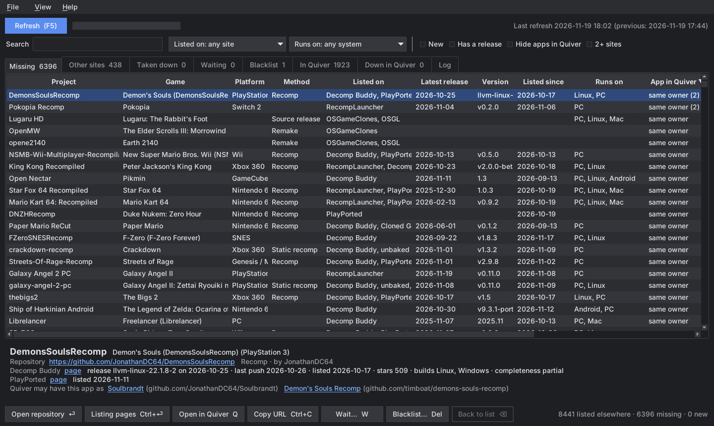

# Quiver Scout

A maintainer tool for the [Quiver Launcher](https://quiverlauncher.com) catalog. It reads every app Quiver lists,
reads the recomp and port listings on other sites, matches them by repository, and shows what Quiver is missing.
Then you can open each one, wait for the ones that aren't ready, and blacklist those that don't belong.



## What it reads

| Source | How | After the first refresh |
| --- | --- | --- |
| **Quiver Launcher** | `api.quiverlauncher.com/api/v1`, the API the launcher uses: `/release-status` for each app's repository and newest release, `/apps` for names and games. Or a CSV export (see Settings). | `/release-status` (~20 requests); `/apps` only for apps it hasn't seen |
| **RecompLauncher** | `recomplauncher.com/pc-catalog.json`, its whole PC catalog, with each project's latest release. | Downloaded only when it changed |
| **Decomp Buddy** | `tanookistudios.com/decomp-buddy/catalog.json`, the catalog it publishes for anyone to use, with each project's latest release, last push and published builds. | Downloaded only when it changed |
| **unbaked** | `unbaked.games/api/additions.json`, every project added in the last several weeks. Optionally every game's full record (Settings). | Downloaded only when it changed; full scan: only games with new pushes |
| **PlayPorted** | `playported.com/sitemap.xml`, then each port's page for its project link (~2,100 pages the first time). | Only new or changed port pages |
| **OSGameClones** | `osgameclones.com`, every project on one page: remakes, official source releases, and clones. | Downloaded only when it changed |
| **Cloned Games** | `clonedgames.com/sitemap.xml`, then each project's page for its repository and original game (~4,200 pages, ~120 MB the first time). Its `/api/` is off limits by its robots.txt, so it isn't used. | Only new or changed pages |
| **OSGL** (Trilarion) | `trilarion.github.io/opensourcegames`, the Open Source Games List: 27 letter pages with each game's repository and what inspired it. Remakes and clones only; original games are left out. | Each page downloaded only when it changed |
| **Twitter/X** | The X accounts you follow (Twitter/X tab), read through [FxTwitter](https://fxtwitter.com)'s public API, no login: every link to a project in their posts. | Only posts newer than the last read; the whole history the first time |

A refresh where nothing changed takes about ten seconds and downloads almost nothing: catalog files come back as
"not modified", and page caches only fetch what the sitemaps say is new. **Full refresh** (Shift+F5) ignores
what's cached and reads everything again.

**Clones** are new games in the style of an old one, not ports of it, so Quiver can't offer them for the original.
OSGameClones, Cloned Games and OSGL list many; they're left out unless **Settings → Include clones** is on. Cloned
Games calls everything that isn't a decompilation or recompilation a clone, source ports too, so those of its
projects count as clones here; most are also on OSGameClones or OSGL as remakes.

**Forgejo and Gitea** run on anyone's server, so a project on a site the tool doesn't know is checked the way Quiver
Launcher checks one: the site is asked for `/api/v1/version`, which Forgejo and Gitea answer. Only addresses shaped
like a repository (`site/owner/name`) are checked, each site once; sites that aren't forges are asked again after 30
days, and sites that didn't answer after a day. A project on a Forgejo/Gitea site goes to Missing, not Other sites.

Platforms and methods are written one way whichever site they come from: `ps2`, `PS2` and `PlayStation 2` are all
*PlayStation 2*, `gba` is *Game Boy Advance*, `x360` is *Xbox 360* (see `quiver_scout/names.py`).

Projects are matched by repository, whatever form the link takes: `https://GitHub.com/Owner/Repo.git`,
`github.com/owner/repo/releases/tag/v1` and `http://www.github.com/owner/repo/` are the same project. GitLab
subgroups, Codeberg and other Gitea/Forgejo hosts, and project sites that aren't on a code host are handled too.

## Download

On Windows, download **QuiverScout.exe** from the
[latest release](https://github.com/CuddleBear92/quiver-scout/releases/latest) and run it. Nothing to install, no
Python needed. Windows SmartScreen may warn about an unknown publisher the first time: *More info → Run anyway*.

It looks for a newer build each time it starts (and from **Help → Check for updates…**). When there is one, it shows
what changed and offers to download it: it checks the download against the SHA-256 GitHub lists, swaps it in and
restarts. Say no and it doesn't ask again until the build after. **Settings → API keys** can turn the check off.

## Run it from source

It needs Python 3.9 or later and nothing else. On Windows, the python.org installer includes Tkinter, which the
window uses. On Linux you may need your distribution's `python3-tk` package.

```bash
git clone https://github.com/CuddleBear92/Quiver-Scout
```

```bash
cd Quiver-Scout
```

```bash
python -m quiver_scout
```

On Windows you can also double-click `Quiver Scout.pyw`. Or install it, which adds `quiver-scout` and
`quiver-scout-gui` commands:

```bash
pip install .
```

## The window

| Tab | What's in it |
| --- | --- |
| **Missing** | Projects other sites list that Quiver doesn't, on a code host Quiver reads releases from: GitHub, GitLab, and Forgejo/Gitea servers such as Codeberg (see below). Bitbucket isn't counted: the launcher's code has a Bitbucket provider, but the catalog has no app from it. Bold rows are new in the last refresh. |
| **Other sites** | The same, but on a site Quiver can't read yet: SourceForge, itch.io, Bitbucket, a project's own website, a web port. Kept apart for when Quiver supports custom sites. |
| **Taken down** | Projects whose link was found deleted, blocked (DMCA), disabled, or unreachable (see *Checking links*). Kept out of Missing and Other sites. |
| **Waiting** | Projects you're waiting on, and why: Quiver must support its site first, no source code yet, no release file yet, or something else, with a note. A green row is in Quiver now, so you can take it off the list. |
| **Blacklist** | Projects you decided not to add, with a reason and a note. Grey rows are no longer listed anywhere. |
| **Linked** | Projects you marked as in Quiver by hand, and the Quiver app each one is: for when Quiver has it at an address no rule can tell (say, a launcher for the game's code). Red rows: that app has left Quiver. |
| **In Quiver** | Quiver's catalog, each app's latest release, and which other sites also list it. |
| **Down in Quiver** | Quiver's own live apps whose repository is taken down, to archive them or swap in a new host. Green rows have a possible replacement (see below). Apps you archive, or whose repository you change, leave it (see *Live check*). |
| **Twitter/X** | The X accounts you follow, and their posts (see *Twitter/X accounts*). |
| **Log** | What each refresh did, and any site that failed. |

Columns include **Latest release**, **Version**, **Last push**, **Listed since**, **First seen** and **Runs on**,
and how popular a project is, to sort the big ones first so none slip by:

| Column | From |
| --- | --- |
| **Stars** | GitHub stars, as RecompLauncher, Decomp Buddy or unbaked give them (the highest) |
| **Downloads** | release downloads, from RecompLauncher or Decomp Buddy |
| **Played (90 days)** | PCs that played it through RecompLauncher in the last 90 days |
| **Score**, **Reports** | RecompLauncher's player-report score (0–100) and how many reports it's from |

PlayPorted, OSGameClones, Cloned Games and OSGL give no such numbers. Numbers sort biggest first on the first click.
The RecompLauncher numbers come from its catalog file and its player-report scores (one more request, only
downloaded again when it changed).

- **Sort:** click a heading. A second click reverses, a third goes back to the list's own order (by game). Dates sort
  newest first, with unknown dates last either way.
- **Reorder:** drag a heading left or right, or right-click it for *Move left* / *Move right*.
- **Hide:** right-click a heading for *Hide*, or tick columns under *Columns*. *Reset columns* puts back the order,
  columns and widths.

Each tab's column order, hidden columns, widths and sorting are saved in `settings.json`.

*App in Quiver* says Quiver likely already has this app at another link ("likely: owner/repo"): a Quiver app with
the same project name (as any site names it) or the same repository name, **and** the same creator (the repository
owner, or the developer a site names). That catches a repository that was renamed or moved to another host. A fork
has another owner and another developer's project called the same another creator, so neither counts. Names too
common to tell apps apart (recomp, decomp, pc-port...) don't count. The details pane links to them. *Game in
Quiver* (hidden at first) is looser: Quiver has some app for the same game.

Filters: search (every word must match the project, game, URL, author, platform, method or note), *Listed on*
(a drop-down of the sites), *Platform* (a drop-down of the original platforms: the console or computer the game
came out on), *Runs on* (a drop-down of the systems projects run on), *New* (in the last refresh),
*Has a release*, *Hide apps in Quiver* and *2+ sites*.

*Runs on* lists every system any site says a project runs on or has builds for (Decomp Buddy's builds, unbaked's and
OSGL's platforms, RecompLauncher's systems), most common first with a count, and *Not known* for projects no site
says anything about. A project that says Android in its name or link counts as Android. To see one system, pick
*No systems*, then tick it.

The details pane, under the list when one project is selected and only as tall as what it says, shows what each
site says about it: its page there, the release it knows of,
the last push, when it was listed, stars, and for Decomp Buddy which systems it publishes builds for (a project with
no builds is likely one to wait for).

The window opens where you left it, at the size you left it, maximized if it was; so does Settings. A place on a
monitor that's no longer there is ignored.

**View → Theme** switches between light, dark, and the system's setting. The menu bar and, on Windows, the title bar
follow too. Alt+F, Alt+V and Alt+H open the menus.

| Key | Action |
| --- | --- |
| F5 / Shift+F5 | Refresh what changed / full refresh |
| Enter / double-click | Open the repository |
| Ctrl+Enter | Open its pages on the listing sites |
| Q | Open in Quiver: the app's page on quiverlauncher.com, or, for a project Quiver doesn't have, the pages of the Quiver apps that may be it (App in Quiver), else of Quiver's apps for the same game |
| Ctrl+C | Copy the selected rows' URLs |
| W | Wait for it (on Waiting: change why) |
| L | Mark as in Quiver: pick the Quiver app it is |
| Delete | Blacklist (on Waiting and Blacklist: back to the list) |
| Backspace | Back to the list, from Waiting or Blacklist |
| Ctrl+A | Select every row |
| Ctrl+1 … Ctrl+5 | Switch tabs |
| Ctrl+F / Esc | Search / clear the search |
| Ctrl+E | Export the current list as CSV |

**Blacklist reasons** are a fixed set, so every entry reads the same and the Reason column sorts and searches
cleanly: *Part of a launcher*, *Decent official PC port available*, *Low quality*, *Banned creator*, *Decomp only,
not a port*, *Needs pirated or bundled game files*, *Fork or duplicate of another project*, *Not a game (engine,
library, tool)*, *Abandoned, never released*, *Unsafe (malware or suspicious files)* and *Other*. The dialog offers
them with keys 1–9 and 0, plus an optional note; right-click has *Blacklist for…* with each one in one click. On the
Blacklist tab, *Change reason…* changes it. The list is `BLACKLIST_REASONS` in `quiver_scout/decisions.py`.

Right-click a row for the same actions, including *Wait for…* with each reason in one click. After waiting or
blacklisting, the selection moves to the next row, so you can work down a list from the keyboard.

When a site fails during a refresh, its items from the previous refresh are kept, so a site being down doesn't make
everything look new or missing. The error is shown in the Log tab.

The first refresh marks everything it finds as already known. After that, each project first found in a refresh
gets that refresh's time in *First seen*, and *New* shows those from the newest one.

## Twitter/X accounts

Some X accounts post new recomps and ports as they come out (@TheEmporium83 is followed to begin with). Follow more on
the **Twitter/X** tab: type `@name` or paste a link to the profile, and **Add**. Each account's row says:

| Column | |
| --- | --- |
| Posts read, Posts on X | how much of its history has been read |
| Last post, Since | its newest post, and how long ago |
| Projects linked | projects its posts link to |
| In Quiver, Missing, Waiting, Blacklisted | where those projects are in your lists |
| Last read, Status | when it was read, and whether its whole history is in |

Under them are the posts of the accounts selected (of all, when none is): the game, which list its project is in,
the post, likes and views, the link. Right-click a post for the same actions as on Missing; right-click an account to
open it on X, read its history again, or stop following it.

Posted projects join every other list under **Twitter/X** in *Listed on*. The game is read from how these accounts
write ("FIRE EMBLEM WARRIORS gets a native Windows and Linux recompilation"), and so is *Runs on*.

**How it reads them, and why no login:** X shows timelines only to logged-in users, and its API costs money; Nitter
instances mostly stopped working in 2024. FxTwitter's public API gives an account's posts 20 at a time, with older
pages after them, no login. It answers "not now" when asked too often, so pages are asked 10 seconds apart and again
after 20–90 seconds when it says so. The first refresh reads an account's whole history (150 posts took 2–8 minutes,
as FxTwitter allowed), at most 50 pages (about 1,000 posts) a refresh, carrying on where it stopped the next time.
After that a refresh reads only what's new: from the newest post back to the first one already read, usually one
page. Reposts are kept, under the account that reposted them. If FxTwitter changes or goes away, the posts read so
far stay.

## Checking links

Listing sites keep projects whose repository is long gone. **File → Check links** (Ctrl+L) checks the links of every
project and every Quiver app that's new or due, and the *Link* column and details pane say what it found:

| Link | Meaning |
| --- | --- |
| ok | there |
| archived | there, read-only |
| moved → owner/name | renamed or moved; it's matched against Quiver under its new name too |
| gone | deleted, or made private (404/410) |
| blocked (DMCA) | GitHub's "Repository access blocked", or HTTP 451 |
| disabled | disabled by GitHub |
| unreachable | the site didn't answer, twice, a day or more apart |

GitHub repositories are checked through GitHub's API, 50 to a request, with a **GitHub token** (Settings → API keys):
about 130 requests for 6,500 repositories. Without a token, each repository's page is loaded instead, two at a time,
and checking stops for the day if GitHub asks to slow down. GitLab and Forgejo/Gitea repositories are checked through
their APIs, other sites by asking for the page. Right-click a row for *Check link now*.

A link is checked again after 14 days if it was fine, 60 if it was taken down, and a day if its site didn't answer.
With a GitHub token, links that are due are checked after every refresh (Settings → Sites can turn that off). In
the In Quiver tab, Quiver apps whose own link is taken down are red.

Only a site failing to answer counts against it: an error on this computer's side doesn't, and when most sites fail
at once the computer is taken to be offline and nothing is marked. **File → Check taken-down links again** checks
every link marked taken down (or not answering) right away, without waiting for it to be due, and clears the ones
that are back, from the shared `taken-down.json` too.

### Live check of Down in Quiver

The catalog Quiver Scout reads from api.quiverlauncher.com is Cloudflare's cached copy, which can be up to 20
minutes behind. So that an app you've just archived, or whose repository you've just changed, leaves Down in Quiver
straight away, every app in that tab is asked about on Quiver's live (uncached) API, one request each:

- archived (the live API doesn't know it): left out from then on, and forgotten once the cached catalog drops it,
- repository changed: the app gets its new repository, which is checked with the next link check.

This runs after every refresh and every link check; **File → Check Down in Quiver against live Quiver**, or
right-click rows in the tab, runs it now. Archived apps are asked again each time, in case they're brought back.

### Replacements for taken-down repositories

Developers often upload the same code to another host after a takedown. For each taken-down repository, Quiver
Scout looks for it elsewhere and lists what it finds as *possible replacements*, best first:

- **same owner and name** on GitHub, GitLab or Codeberg (asked directly), or already listed by a site,
- **same owner** on another host, among projects already listed,
- **same name**, among projects already listed, and by searching GitHub (with a token), GitLab and Codeberg.

Taken-down Quiver apps are looked for every day, when links are checked, so a re-upload shows up soon after it
appears. Other taken-down projects are matched against what's already listed, which costs no requests;
right-click any taken-down row for *Find replacements now*. The *Possible replacement* column shows the best one
(and how many more), the details pane and the right-click menu list them all. Same name isn't proof of same code:
open it and look before swapping the host in Quiver. Replacements are kept with the link in the shared
taken-down list.

## API keys

**Settings → API keys** has a field for a GitHub token and one for a GitLab token, each with a *Create a token*
button that opens the site's page for making one, and *Test*, which says whose token it is and how many requests it
has left. Neither needs any permission: a GitHub classic token with no scopes ticked reads public repositories, and
the GitLab link opens the form with `read_api` ticked.

Tokens are kept in `tokens.json` in the data folder, not in `settings.json`, so settings can be shared and tokens
not. The `GITHUB_TOKEN` and `GITLAB_TOKEN` environment variables work too.

### Marking a project as in Quiver

Sometimes Quiver has a project at an address nothing can match: the listing sites have the game's code, and Quiver
the launcher for it (Longshot is one). Right-click it, **Mark as in Quiver**, and pick the app: the ones *App in
Quiver* and the same game suggest are one click away, and *as another Quiver app…* (or **L**) opens a list of all
of Quiver's apps to search by name, game, slug or repository, with an optional note. The project leaves Missing for
the Linked tab, and counts as that app (In Quiver shows the sites listing it). *Back to list* undoes it. Links are
kept in the decisions file with Waiting and Blacklist, so maintainers sharing it share them.

## Sharing between maintainers

What you decide (Waiting and Blacklist) lives in its own file, `decisions.json`, apart from everything that can be
downloaded again. To share it, point **Settings → Decisions file** at the same file for everyone:

- **A git repository** (best): commit `decisions.json` to a small repo the maintainers share. It's sorted with one
  project per entry, so changes diff and merge cleanly.
- **A synced folder** (Dropbox, OneDrive, Google Drive): works as long as two people don't change it in the same
  minute.

Every change reads the file again first and writes back only that change, so one maintainer's edits don't undo
another's. The window also reloads it when you come back to it. Set **Your name** in Settings to have it on each
decision.

Links found taken down or moved go in a second shareable file, `taken-down.json` (**Settings → Sharing →
Taken-down list**), merged the same way. A link someone else checked more recently than you is taken from it instead
of being checked again, so maintainers sharing it split the requests between them. Links found fine again are taken
off it.

### Sharing a file once: import and export

Without a shared folder or repository, maintainers can send each other the files instead. **File → Export
decisions…** and **File → Export taken-down list…** save a copy; **File → Import decisions or taken-down list…**
merges a copy someone sent into yours (it tells which kind it is by what's in it, and takes version 0.1's
`blacklist.json` too):

- projects or links you don't have are added,
- ones you both have keep whichever is newer (yours when they're from the same day),
- nothing of yours is removed: a project someone took off their blacklist stays on yours.

It reports how many were added, replaced and kept. The command line does the same with `import FILE` and
`export decisions|taken-down FILE`.

The database (`scout.db`) is a local cache: everyone keeps their own and a refresh rebuilds it. Don't put it in a
synced folder.

## Command line

```bash
python -m quiver_scout quiver-csv quiver-catalog.csv
```

writes Quiver's catalog: title, game, url, provider, slug, developer, type, added, latest release, version and Quiver
page.

```bash
python -m quiver_scout missing missing.csv --refresh
```

refreshes and writes the projects Quiver is missing. `--list other`, `--list taken`, `--list waiting`,
`--list blacklist` or `--list all` writes another list instead, and `--new-only` keeps only those new in the last
refresh. Every list has `link`, `link_checked` and `moved_to` columns.

```bash
python -m quiver_scout check-links
```

checks the links that are new or due; `--all` checks every one again.

```bash
python -m quiver_scout refresh
```

only refreshes, for running on a schedule. `--full` reads everything again.

## Settings and data

Settings are in File → Settings, in three tabs: **Sites** (which to read, the unbaked full scan, clones, checking
links after refresh, a Quiver CSV to use instead of the API), **Sharing** (the decisions file, the taken-down list,
your name) and **API keys**.

**Quiver CSV**: when Quiver's admins export the catalog, pick the file here. It needs a URL column (`url`,
`repository`, `repo`, `source` or similar), and uses `title`, `game` and `slug` columns when it has them.

Everything lives in one folder (File → Open data folder): `%APPDATA%\quiver-scout` on Windows,
`~/Library/Application Support/quiver-scout` on macOS, `~/.local/share/quiver-scout` on Linux. `--data-dir` or
the `QUIVER_SCOUT_HOME` environment variable puts it somewhere else.

| File | What |
| --- | --- |
| `settings.json` | Options, sort orders, columns, and window sizes and places |
| `decisions.json` | Waiting and Blacklist (shareable, see above) |
| `taken-down.json` | Links found taken down or moved (shareable, see above) |
| `tokens.json` | GitHub and GitLab tokens. Never share it. |
| `scout.db` | SQLite: each source's items (table `items`), pages already read (`pages`), the ETag or Last-Modified of each catalog file (`http_cache`), when each project was first seen (`seen`), and each link's last check (`links`) |

Version 0.1's `snapshot.json`, `seen.json`, cache and `blacklist.json` are moved in on first start; nothing is read
again.

## Adding a site

Each site is a module in `quiver_scout/sources/` with a `fetch(ctx)` that returns `Item`s (a project URL, its name
and game, its page on that site, and any dates it knows). `ctx.json(url)` downloads a file only when it changed. Add
it to `EXTERNAL` in `sources/__init__.py` and to `_fetch_one` in `engine.py`.

## Releases

`.github/workflows/release.yml` makes a release every time `main` changes (and from **Actions → Build and release →
Run workflow**): it runs the tests on Linux, builds `QuiverScout.exe` with PyInstaller on Windows, and publishes it as
a release tagged `build-N`, N being the run number, one higher every time. The build number is stamped into the exe
(`quiver_scout/_build.py`, which is 0 in the source), and that's what the app compares to tell when there's a newer
one; builds are just numbered, Build 1, Build 2, and so on. The release notes are the merged branch's commit
message. The exe gets the arrowhead icon in `quiver_scout/assets` (drawn by `tools/make_icon.py`, which needs
Pillow; the app doesn't). Changes to Markdown files and `docs/` alone don't
make a release.

## Tests

```bash
python -m unittest discover -s tests
```

## License

[MIT](LICENSE)
